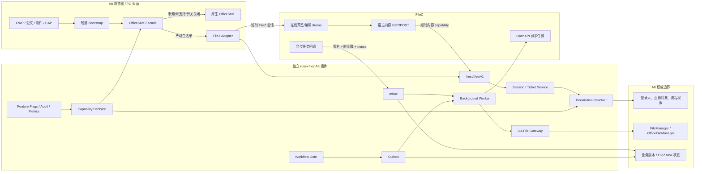
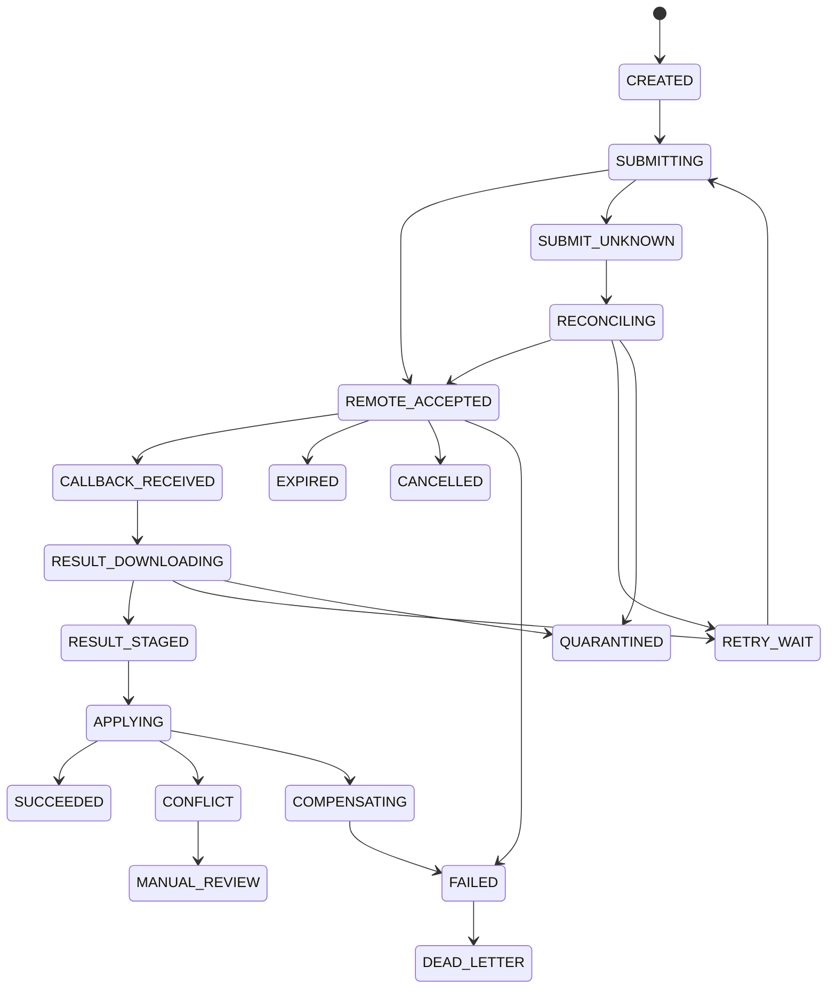

# 致远 A8 V10 与 FileZ 低侵入/零源码侵入集成研究报告

> 研究日期：2026-07-31  
> 研究对象：`D:\Java-project\v10.0瑞安源码`、`D:\vue-projects`、`E:\Seeyon\A8`  
> 研究方式：32 个专项视角分批轮转，覆盖产品插件机制、OfficeSDK、CWP、公文、附件、CAP、M3、文件存储、权限、安全、异步任务、升级部署、测试、可观测性及官方资料。  
> 边界说明：本报告对 FileZ 客开代码、直接改动的致远前端文件、关键后端链路和关键运行时文件进行了逐文件、逐行核查；对于 `E:\Seeyon\A8` 中数万项产品文件，采用目录盘点、关键字定位、字节码/配置核验和调用链抽样，不虚称逐行阅读了全部第三方与产品文件。  
> 安全说明：报告不展示已发现的真实密钥、口令、完整签名 URL 或个人信息。

---

## 0. 最终结论

### 0.1 直接回答

**有更好的集成方式，而且可以把“每次致远升级都要重新合并 CWP/公文源码”的问题基本消除。**

当前首选的**候选架构**是：

> **独立 FileZ 插件 + 致远扩展点加载轻量 Bootstrap + 条件化 OfficeSDK Facade/Adapter + 版本化 REST + 分层会话/能力票据 + 文件网关 + Outbox/Inbox 异步状态机 + 功能开关。**

这一路线并非已经被证明可以安全落地。以下四类 D 级门槛必须先通过 PoC：

1. FileZ 可验证的 durable commit/version/checksum；
2. 致远受支持的文件保存、版本 CAS 和失败补偿边界；
3. 所有会改变正文的流程入口均经过同一个服务端 Gate；
4. 对象级授权以及无需修改核心白名单的安全内容/回调通道。

任一门槛失败，生产范围必须收缩为**只读预览**，不能开放编辑保存。

它可以实现以下结果：

- 不修改 CWP 的 `main.js`、附件 Vue 组件及其 store/handle；
- 不修改公文的 `main.js`、附件 Vue 组件及其 action/handle；
- 不修改致远标准 `officeSDK.js`；
- 不修改致远核心 Java 源码和核心 JAR；
- 不再把 FileZ 下载、上传、回调方法直接写入致远核心免登录白名单源码；
- 升级时从“合并标准源码”转变为“安装独立插件、运行兼容性测试、必要时只调整兼容层”；
- 关闭开关即可让新会话回到原生 OfficeSDK，回滚不再依赖恢复整个前端构建包。

但必须区分三个层次：

| 目标 | 当前是否可实现 | 准确结论 |
|---|---|---|
| 不修改致远标准源码 | **设计目标可做到** | 须通过第 20 章 PoC 后才能确认生产可行性 |
| 不改任何运行行为 | **不可以** | FileZ 要接管编辑器，必然通过插件、配置或 Facade 改变运行行为 |
| 成为致远后台可配置、PC/M3 都原生识别的正式编辑器厂商 | **当前本地 V10 不可以单方完成** | 需要致远新增正式 `FILEZ provider`、产品枚举、能力矩阵和公开适配器 SPI |

因此，最准确的项目承诺不是“永久绝对零侵入”，而是：

> **消除致远标准源码补丁和同文件合并冲突，把升级影响收敛为独立插件适配、部署重放和自动化契约回归。**

### 0.2 推荐的双轨路线

**近期主线：由本项目落地独立插件方案。**

- PC 一期先覆盖附件预览、CWP/公文 Word 正文查看与编辑；
- 未完成合同验证的 PDF、OFD、PPT、签章、复杂套红、清稿、转换等继续走原生；
- M3 一期保持原生，作为独立二期，不把 PC 完成误认为全产品完成；
- 所有 FileZ 保存必须以“A8 已可靠落盘且校验成功”为成功条件。

**长期主线：推动致远提供正式 FileZ Provider。**

- 正式增加 `ProductType.FILEZ`；
- 把适配器 URL、产品选择及能力矩阵从硬编码改为可扩展配置；
- 公开 Adapter/Provider SPI；
- 定义 PC/M3、保存、版本、事件、错误和回滚合同；
- 由致远对后续升级兼容承担明确责任。

### 0.3 当前版本的上线判断

**当前实现不适合继续扩大生产使用范围。**  
这并非只是“升级维护麻烦”，而是已存在必须先收口的 P0 问题：

- 前端存在 `saveFile` 模拟成功/静默放行；
- FileZ 会话权限被固定为读、写、下载、打印全开；
- 匿名下载、上传和四类回调缺少完整对象授权、签名、防重放与幂等；
- 上传可以依据可控 `fileId` 直接覆盖文件，并信任客户端 `memberId`；
- 文件写入绕过致远文件管理边界，数据库元数据与物理文件可能不一致；
- 异步任务缺少状态、类型、源版本、目标版本、过期、乱序和一次性消费控制；
- 旧回调可能覆盖新正文；
- 浏览器层修改附件 `canLook/canPreview`，混淆“是否有转换能力”和“是否有业务权限”；
- 源码和本地产品配置中存在明文 FileZ 凭据或真实环境地址，应立即轮换，不应继续沿用。

---

## 1. “致远升级覆盖客开”的根因

### 1.1 当前 FileZ 直接修改了 5 个致远前端标准文件

| 模块 | 标准文件 | 当前修改 |
|---|---|---|
| CWP | `D:\vue-projects\cwp-front\pc-collaboration\src\main.js` | 直接导入并执行 `@/custom/filez` |
| CWP | `...\accessory-item\components\handle\index.vue` | 改附件查看入口和 `canLook` |
| CWP | `...\accessory-item-new\components\file-handle.vue` | 改新附件入口和 `canLook` |
| 公文 | `D:\vue-projects\apps-edoc-front\edoc-summary\src\main.js` | 直接导入并执行 `@/custom/filez` |
| 公文 | `...\components\attachment-list\table.vue` | 替换原生附件预览入口并放开 `canPreview` |

直接证据：

- CWP `main.js:11-16` 导入并执行 FileZ；
- CWP 两个附件组件分别在 `94-96`、`109-111` 把 `canLook` 改为“原值或 FileZ 白名单”；
- 公文 `main.js:5-11` 导入并执行 FileZ；
- 公文附件组件 `110-119` 用 FileZ 入口取代原生入口，`193-195` 和 `343-358` 直接调用 FileZ Adapter。

只要致远升级恰好修改这些文件，客开就会面临三种失败：

1. 标准包覆盖客开文件，FileZ 功能直接消失；
2. Git 能合并文本，但新版本调用语义已经变化，构建成功后运行错误；
3. 客开文件覆盖新标准包，致远修复或新功能被回退。

### 1.2 客开前端代码已经形成第二套 Office 生命周期

当前两套 FileZ 自定义目录共有 **15 个文件、2,881 行**：

| 模块 | 文件数 | 物理行数 |
|---|---:|---:|
| CWP `src/custom/filez` | 8 | 1,205 |
| 公文 `src/custom/filez` | 7 | 1,676 |

这些代码没有只做“编辑器适配”，而是自行接管或补丁化了：

- OfficeSDK 构造、原型和保存；
- CWP `zwIframe` 中的编辑器；
- `OfficeV2.prototype.editOfficeTrans`；
- Vue 正文容器 DOM；
- 附件查看按钮和 `canLook/canPreview`；
- 公文 store、actions 和 handles；
- FileZ 地址构造；
- 新文件 ID 生成；
- `contentAPI` 回写；
- 套红、清稿、转换任务轮询。

这意味着升级风险不只来自 5 个直接修改的文件，还来自大量私有 DOM、参数、事件、store 和原型假设。

### 1.3 “5 个 Vue 文件”不是全部产品侵入面

前述 5 个文件是当前 CWP 和新公文真源中最直接、最确定的 FileZ 修改点；全产品迁移不能只恢复这 5 个文件。其他需要与纯净致远包逐项核对和退场的区域还包括：

| 区域 | 已发现的 FileZ/客开形态 | 终态 |
|---|---|---|
| 老公文 | `edoc.js`、`edocSummary.jsp` 内嵌拦截、下载按钮和脚本 | 提取为独立 host bundle，标准大文件恢复原版 |
| apps-doc | `DocController.java`、`knowledgeBrowse.jsp` 等查看补丁 | 页面宿主适配 + 登录态 context API，恢复原版 |
| CAP PC/Mobile | `cap4-attachment.vue`、移动 bridge、FileZ 控件资源 | 独立表单控件/附件 provider，恢复标准组件 |
| 组织/系统菜单 | `menu-SystemAdmin.xml` 客开菜单 | 插件自带管理员菜单资源 |
| mplus/内容组件 | `OfficeContent.prototype.initOfficeSDK` 覆盖 | 迁入移动 host adapter，标准源码恢复 |
| M3 运行包 | 协同、公文、附件、CAP、文档中心的已打包/压缩 JS 直接改动 | 生成可重建的独立 M3 包；无扩展点场景暂留原生或 legacy |
| apps-api | 为 apps-doc 补丁暴露的 `EuApi` | apps-doc 恢复后删除 |

因此最终“源码纯净度”应对以下整个目录与同版纯净包比较，而不是只看两个 Vue 项目：

```text
cwp-front
apps-edoc-front
apps-doc
cap-front
ctp-core
ctp-organization
mplus-front
产品 M3 原版包
```

### 1.4 后端还修改了核心安全配置

以下两个致远核心资源已经加入 FileZ 匿名入口：

- `ctp-core\src\main\resources\needless_check_login.xml:4-11`
- `ctp-core\src\main\resources\needless_check_login_recheck.xml:5-13`

放开的方法包括：

- `download`
- `uploadFile`
- `fileZredReturn`
- `fileZpdfReturn`
- `fileZwaterReturn`
- `fileZclearReturn`

它们既是升级冲突点，也是安全边界被绕开的根因。目标架构必须把回调认证放到独立插件或独立网关中，不能再依赖修改致远核心白名单源码。

### 1.5 Git 自动重放补丁不能解决根因

Git patch、`git apply`、标记块和自动 cherry-pick 可以保留为升级差异取证工具，但不能当作架构：

- 它只能判断文本是否能应用，不能证明新版本参数和回调语义仍一致；
- 没有冲突不代表没有语义漂移；
- 新增入口可能没有补丁；
- 文件保存、权限和事务边界变化无法靠文本补丁验证；
- “自动成功”会制造比显式冲突更危险的隐患。

---

## 2. 本地 V10 OfficeSDK 的真实扩展能力

核查文件：

`E:\Seeyon\A8\ApacheJetspeed\webapps\seeyon\common\office\js\officeSDK.js`

### 2.1 它确实有 Adapter 抽象

| 行号 | 实现事实 | 含义 |
|---:|---|---|
| 12-14 | 如果 `window.OfficeSDK` 已存在则整段返回 | 只能存在一个全局 SDK；早期装载顺序很关键 |
| 16 | `pluginManager` 是闭包私有对象 | 外部不能直接修改注册表 |
| 387-394 | `mergePrototype` 把默认 API 补到 Adapter 原型 | 第三方 Adapter 可以只实现真实支持的方法 |
| 402-406 | `OfficeSDK.register(name, plugin)` | 具备注册 Adapter 构造器的机制 |
| 413-415 | `getAdapter(name)` | 按键取 Adapter |
| 1295-1309 | 请求 `/rest/office/config/adapter/mapping` | 产品选择来自后端配置 |
| 2583-2627 | 计算文档类型、模式和 Adapter key | Word/Excel/PDF/OFD/PPT/TEXT/IMG/ZIP 统一路由 |
| 2670-2677 | 按 key 取 Adapter，并以 `(params, utils, sdkInstance)` 构造 | FileZ 可实现同一对象合同 |
| 2975 | 同时导出 `window.OfficeSDK` 和 `window.$SDK` | Facade 必须同时保持两者兼容 |

这证明正确方向不是继续在 CWP、公文中分别写一套 FileZ 生命周期，而是实现一个与 OfficeSDK 合同一致的 FileZ Adapter。

### 2.2 但当前 V10 的“第三方 Provider 发现”是半封闭的

`officeSDK.js:37-45` 的 `ADAPTER_KEY` 只包含既有产品：

- `ONLINE_EDIT_WDT`
- `ONLINE_EDIT_KINGSOFT`
- `ONLINE_EDIT_KINGSOFT_WPS`
- `ONLINE_PREVIEW_KINGSOFT`
- `ONLINE_PREVIEW_SUWELL`
- `ONLINE_SIGN_SUWELL`
- `ONLINE_PREVIEW_ASPOSE`

`officeSDK.js:2624-2627` 最终执行：

```js
return {
  key: key,
  url: ADAPTER_KEY[key]
};
```

本地后端同时存在固定的：

- `OfficeConfigEnum.ProductType`
- `plugin_mode_product_init.json5` 产品/能力矩阵
- `spring-office-common.xml` 配置 Bean

其中均没有 FileZ。

因此：

> 单独执行 `OfficeSDK.register("ONLINE_EDIT_FILEZ", FileZAdapter)` 不够，因为前面的后端映射和前端 `ADAPTER_KEY` 无法生成并加载这个新 key。

### 2.3 为什么不应冒充 WDT

把 FileZ 注册成 `ONLINE_EDIT_WDT` 看似能避开硬编码，但生产上不成立：

- `OfficeSDK.register` 是“首次注册生效”，结果依赖加载顺序；
- WDT 不只是一个 URL key，还绑定 WDT 的后端配置、JWT、命令、事件、保存和版本语义；
- 公文上层代码会按 WDT/Kingsoft 分支调用特有能力；
- FileZ 若没有完全等价的能力，容易再次出现“方法存在但伪成功”；
- 致远升级 WDT Adapter 时，FileZ 会与标准 Adapter 争夺同一个 key。

结论：**WDT key 兼容仅允许隔离 PoC，不作为生产架构。**

### 2.4 为什么近期采用 Facade，而不是修改 `officeSDK.js`

Facade 的职责是：

1. 保存真实的原生 `OfficeSDK`；
2. 只对严格白名单的“模块 + 文件类型 + 模式 + 操作”构造 FileZ Adapter；
3. 其他全部委托给真实 SDK；
4. 保持静态属性、原型、事件、Promise 和回调合同；
5. 任何未知枚举或缺字段都安全透传原生；
6. 通过一个独立兼容层吸收未来 OfficeSDK 变化。

它仍然属于运行时接管，不是致远正式 Provider；但它把风险从多个 Vue 源码文件收敛到一个可测试、可关闭、可替换的兼容层。

---

## 3. 官方资料能支持到什么程度

### 3.1 致远官方推荐的无源码修改路线

致远《如何定制开发》把以下方式列为定制路线：

1. 独立插件；
2. RESTful API；
3. Event Listener；
4. APPS API；
5. Dynamic Interface/Bean 替换；
6. 前述方式不能满足时才修改标准源码。

官方也明确指出，直接修改标准源码会在产品后续修改同一文件时产生合并问题。  
来源：[致远开放平台：如何定制开发](https://open.seeyoncloud.com/v5devCTP/38/48.html)

这为“独立插件替代源码补丁”提供了官方方向依据。

### 3.2 OfficeSDK 的官方定位

致远从 V9.0SP1 开始提供统一 OfficeSDK API，目标是避免把新编辑器产品继续写进产品核心 `if/else`。公开文档包含 `init`、`openFile`、`saveFile`、`destroy`、`close` 等统一接口和 Promise/回调使用方式。  
来源：[致远 OfficeSDK 技术说明](https://open.seeyoncloud.com/v5devCTP/1842/1851/1999.html)

但其“三方插件使用”章节仍未完整公开，不能把本地源码中的 `register`、私有映射和加载顺序表述为跨版本正式承诺。

### 3.3 已纳管 Adapter 会动态加载

金山中台适配文档说明，页面只引入 `officeSDK.js`，OfficeSDK 根据后台配置选择并动态加载 Adapter。  
来源：[金山中台适配 OfficeSDK](https://open.seeyoncloud.com/v5devCTP/1842/1851/2045.html)

准确结论是：

> OfficeSDK 能动态加载“致远已经纳管”的 Adapter。

不能推导为：

> 后台随意增加一个 FileZ 名称和 URL 就能接入任意第三方 Adapter。

### 3.4 WDT 文档给出了保存和版本的底线

致远 WDT 文档使用 `fileId + updateDate` 构造文档版本 key，并描述 Ctrl+S、强制保存、离线回调和 `keystatus`。  
来源：[文档通在线编辑技术说明](https://open.seeyoncloud.com/v5devCTP/1842/1851/1996.html)

官方机制表明：

- 编辑器保存成功不等于 OA 保存成功；
- OA 必须收到最终内容、完成落盘并更新版本；
- 旧版本 key 不能继续覆盖新内容；

据此，本项目必须另外设置流程保存门禁，确保流程提交前真实保存完成；这是本项目的一致性要求，不是把 WDT 文档扩张为对所有业务流程的官方承诺。

### 3.5 FileZ 官方支持的宿主集成模式

FileZ 官方提供标准/前端集成、服务端 OpenAPI 和 WOPI：

- [FileZ 开始集成](https://api.filez.com/office/docs/docs-api/get-started/start/)
- [FileZ 产品/API 概览](https://api.filez.com/office/docs/docs-api/get-started/overview/)
- [FileZ 被动传参快速开始](https://api.filez.com/office/docs/docs-api/online-view-editor-api/api2/quickstart/)
- [FileZ OpenAPI 概览](https://api.filez.com/office/docs/docs-api/open-api/overview/)
- [FileZ OpenAPI 快速开始](https://api.filez.com/office/docs/docs-api/open-api/server-development/quickstart/)
- [FileZ API 与 WOPI 对比](https://api.filez.com/office/docs/docs-api/using-wopi/api-vs-wopi/)

FileZ 的“被动传参”并不是零后端开发。宿主仍需实现：

- 用户与权限 Profile；
- 文档元数据；
- 内容下载；
- 内容保存；
- 签名、版本、并发和回调安全。

---

## 4. 本地产品中可利用的扩展点

### 4.1 扩展点总表

| 扩展点 | 适合做什么 | 是否建议作为主链路 | 主要边界 |
|---|---|---|---|
| 独立 customer/plugin JAR | 后端服务、REST、Bean、事件、配置、任务 | **是** | 安装和类加载顺序需 PoC |
| `GlobalJsExtend` | 在实际加载 global env 的同一 window 注入极小 Bootstrap | 早期装载候选 | 不自动覆盖 `content.jsp`/子 iframe，需逐入口 PoC |
| `GlobalEnvExtend` | 注入无敏感信息的环境/能力摘要 | 辅助 | PC/mobile 分派需实测，不能下发密钥 |
| `CollaborationPlugin` | CWP 指定场景加载 JS/CSS 资源 | **是，CWP 页面增强** | 资源内事件/UI 需另行绑定并验证时序 |
| `BusinessOpenApi.getMainBodyDisplayJSPath()` | 正文页在 OfficeSDK 后、正文回调前注入 JS | 备用/精准补点 | 单值覆盖、接口过宽、多个实现顺序不明确 |
| `/common/extend` manifest | 有 `pageCode` 页面加载资源 | 否，非主链路 | CWP/公文目标页未稳定提供需要的 `pageCode` |
| Collaboration `EventDo` | 协同前/后/异步事件 | **是** | 事务内只做本地快速校验，不调用远程 FileZ |
| `WorkflowEvent` | 流程提交前门禁、提交后记录 | **是** | before 可阻断，after 不应假装可回滚流程 |
| `GovdocPermissionOperationExtend` | 公文操作元数据 | 辅助 | 未发现稳定公开的前端 `registerHandle` |
| `FormFieldCustomCtrl` | CAP 表单专用 FileZ 控件 | **是，仅 CAP 场景** | 不能替代全部正文和附件入口 |
| M3 独立 LIB/APP 包 | 新 FileZ 移动页面或控件 | 二期 | 不能自动替换全部原生移动 Office 行为 |
| Dynamic Interface/Bean 替换 | 官方接口不足时挂接或替换行为 | 次选 | 行为侵入较强，应取得致远确认 |

### 4.2 独立插件载体

本地产品：

`E:\Seeyon\A8\ApacheJetspeed\webapps\seeyon\WEB-INF\cfgHome\base\systemProperties.xml:21-25`

已启用：

```xml
<loadCustomerPlugin>
  <enabled>true</enabled>
</loadCustomerPlugin>
```

建议使用独立命名空间和独立资源：

```text
WEB-INF/lib/customer/ruian-filez-a8.jar
WEB-INF/cfgHome/plugin/ruian-filez/
WEB-INF/cfgHome/component/ruian-filez/
apps_res/ruian-filez/
```

注意事项：

- 类名、Spring beanId、REST 路径全部使用 `com.ruian.filez.a8` / `ruianFilez...`，不复用 `eu` 或致远标准名称；
- customer 目录会递归加载 JAR，同一插件只能保留一个版本；
- 插件 XML 可以在后续 Bean 实例化阶段引用 customer JAR 中的类；
- 不优先使用 `<initializer>`，因为初始化器可能早于 customer 类加载；
- 插件私有依赖应 shade/relocate，致远已提供的依赖设为 `provided`；
- 不假设升级安装器会保留未知文件，必须用可重放部署包在每次升级后重新安装并校验。

### 4.3 `GlobalJsExtend` 的正确用法

它只覆盖实际加载 `/rest/global/v1/env` 或 `/rest/global/v1/mobile-env` 的**同一个 window**。正文 `content.jsp` 的部分分支使用 `main.do?method=headerjs`，父窗口注入不会自动进入正文子 iframe。因此它是候选装载点，不是已证明覆盖全产品的单一主链路；正文 iframe 必须逐入口验证，必要时由 `BusinessOpenApi` 精准补点。

本地证据为 `seeyon-ctp-core.jar` 中的 `com.seeyon.ctp.common.web.GlobalJsExtend`、其 `META-INF/services/...GlobalJsExtend` ServiceLoader 注册以及 `HeaderJsUtil`；这些都是当前产品实现证据，不等同于公开跨版本承诺。

只注入 1—5 KB 的幂等 Bootstrap，不把全部 FileZ 业务代码塞进全局头：

- 检查页面/终端/模块；
- 获取服务端 capability decision；
- 仅目标页加载带版本号和完整性校验的 Adapter bundle；
- 安装一次性 SDK 装载观察器；
- 设置版本指纹和故障状态；
- 非目标页面不请求完整 FileZ bundle。

必须特别处理 `officeSDK.js:12-14`：

- Bootstrap 不能提前放一个 truthy 的 `window.OfficeSDK`，否则标准 SDK 会直接 `return`；
- 若采用属性 setter 捕获后续赋值，getter 在真实 SDK 加载前必须返回 `undefined`；
- 捕获完成后恢复正常可写属性，避免永久劫持全局变量；
- 不允许 20 ms 永久轮询；
- 属性不可配置、ES Module、闭包缓存、跨域 iframe 等情况必须安全退回原生。

当前 V10 源码只证明 ServiceLoader、脚本顺序和 setter 方案具备实现条件；全入口、跨 iframe、重复加载和卸载尚待端到端 PoC。该机制不是官方跨版本保证，必须放在单一兼容层并由 L0 契约测试保护。

### 4.4 `CollaborationPlugin`

当前前端消费点位于：

`D:\vue-projects\cwp-front\pc-collaboration\src\utils\plugin-resource-extend.js:56-77`

接口类位于本地 `seeyon-ctp-workflow-api.jar`，可返回 `JavascriptResource/CssResource`，并区分协同 PC/移动发送、处理等 scope。

适合：

- 在 `COLL_PC_SEND`、`COLL_PC_DEAL` 等协同场景加载 FileZ 页面资源；
- 加载独立 CSS/JS；
- 由自有 JS 在验证加载时序后绑定页面事件或增加状态/按钮；
- 避免修改 CWP `main.js` 和附件组件。

不适合：

- 负责最早期 OfficeSDK 捕获；
- 在页面加载时同步访问 FileZ；
- 修改 CWP store 或标准组件内部状态。

### 4.5 `BusinessOpenApi`

本地 `content.jsp` 链路可在 `officeSDK.js` 已加载、`contentCallBack` 前加载 `getMainBodyDisplayJSPath()` 返回的 JS，因此适合作为正文页精准补点。

限制：

- 多个 Bean 可能争用同一个 model 值；
- 实现顺序不明确；
- 接口职责较宽；
- 只覆盖正文页，不覆盖附件、其他 PC 页面和 M3。

建议只在 `GlobalJsExtend` 无法稳定覆盖正文加载时作为备用，不把全部架构压在该点上。

### 4.6 事件和工作流

正确分工：

- **before 事件**：只做本地状态检查；如果最新 FileZ 内容未提交，明确阻断发送/提交；
- **业务事务中**：写入 outbox 和业务版本，不做 FileZ HTTP 调用；
- **after/async 事件**：触发异步任务或审计，不声称能回滚已经完成的业务事务；
- **FileZ 回调**：进入 inbox，后台 worker 验证、下载、校验、落盘、CAS 更新；
- **Workflow Gate**：只有最新版本已 durable commit 才放行。

当前 `WatermarkEvent` 在 before 阶段做外部调用的方式应迁出事务临界区。

---

## 5. 候选方案目标态比较与评分

以下分数是**满足本报告所有安全、一致性和厂商前提后的目标态潜力**，不是当前版本的生产成熟度。评分采用 1—5 分，5 分最好；“成本”一栏代表低成本得高分。权重为：侵入性 15%、升级韧性 18%、功能覆盖 14%、安全 12%、数据一致性 14%、实施成本 7%、官方支持 7%、回滚 6%、移动端 7%。

| 方案 | 侵入 | 升级 | 功能 | 安全 | 一致性 | 成本 | 官方 | 回滚 | 移动 | 总分 |
|---|---:|---:|---:|---:|---:|---:|---:|---:|---:|---:|
| 致远正式 `FILEZ provider` | 5 | 5 | 5 | 5 | 5 | 1 | 5 | 5 | 4 | **93.0** |
| 独立插件 + Facade + REST/票据 + outbox/inbox | 5 | 4 | 4 | 5 | 5 | 2 | 3 | 5 | 2 | **82.4** |
| WOPI sidecar | 4 | 4 | 3 | 5 | 4 | 1 | 2 | 4 | 4 | **72.6** |
| 冒充 WDT key | 4 | 3 | 2 | 3 | 3 | 4 | 2 | 4 | 2 | **60.0** |
| 单纯全局 JS 劫持 | 5 | 3 | 3 | 2 | 1 | 5 | 2 | 5 | 1 | **59.0** |
| Git 自动重放源码补丁 | 2 | 2 | 5 | 3 | 3 | 3 | 1 | 2 | 2 | **53.6** |
| 继续修改致远/Vue 源码 | 1 | 1 | 5 | 2 | 2 | 2 | 1 | 2 | 2 | **40.4** |

当前证据成熟度与项目控制力：

| 方案 | 当前证据成熟度 | 项目可控性 | 说明 |
|---|---|---|---|
| 致远正式 `FILEZ provider` | 低，尚不存在 | 低 | 依赖致远立项、回补和升级承诺 |
| 独立插件方案 | 中低，关键点为 D 级 PoC | 中高 | 主要代码可控，但文件提交、回调入口、Gate 覆盖和 GlobalJS 覆盖尚需证明 |
| WOPI sidecar | 低 | 中 | 需确认 FileZ WOPI 互操作与公文能力 |
| WDT 冒充 | 中，能做实验 | 中 | 技术可试但产品语义不成立 |
| 单纯全局 JS 劫持 | 高，当前已验证可运行 | 高 | 能运行不代表安全、一致或跨版本稳定 |
| Git 自动补丁 | 高 | 高 | 只能重放文本 |
| 当前源码补丁 | 高，当前已存在 | 高 | 正是需要退出的状态 |

### 5.1 评分解释

**致远正式 Provider 得分最高，但不是当前可控的近期方案。**  
它依赖致远研发排期、授权、V10 回补和升级承诺。如果只增加一个枚举而没有公开合同、能力矩阵和 PC/M3 支持，不能称为原生集成。

**独立插件方案是近期最值得验证的候选；只有全部 D 级门槛通过后，才同时具备低侵入、可回滚和可保证一致性。**  
其剩余风险集中在 OfficeSDK 和页面加载扩展点的兼容性，风险可以通过单一兼容层、版本探测、开关和自动化契约测试控制。

**WOPI 值得独立预研，但不应阻塞当前主线。**  
它能提供标准锁与版本语义，却不能自动承载套红、书签、清稿、签章、OFD 等致远公文语义。

**Git patch 只保留为审计和差异工具。**

**单纯全局 JS 劫持、WDT 冒充、继续源码补丁均不得作为生产目标架构。**

---

## 6. 推荐目标架构



### 6.1 权威边界

A8 始终是：

- 用户身份权威；
- 业务对象权限权威；
- 文件元数据权威；
- 当前版本权威；
- 流程状态权威；
- 最终文件存储权威。

FileZ 负责：

- 在线预览；
- 在线编辑与协同；
- 文档内容操作；
- 经许可和互操作验证的转换/内容处理异步计算。

FileZ 返回“成功”不直接改变 A8 流程结果。只有 A8 通过受认证的内容上传回调接收、或按已确认协议主动拉取最终内容，并完成校验、落盘、元数据更新和版本提交后，业务才算保存成功。

### 6.2 内容/回调通道的三选一门槛

PoC 必须证明以下三种方式至少有一种成立：

1. 独立插件可以注册自带认证/授权的内容与回调端点，不修改核心免登录白名单；
2. 使用隔离 `filez-gateway` sidecar；
3. FileZ 支持 A8 主动、受认证、幂等轮询，完全不暴露匿名回调入口。

如果当前 V10 无法通过正式插件扩展安全地接收 FileZ 服务器请求，则优先采用独立 `filez-gateway` sidecar：

```text
FileZ
  -> mTLS/签名
Sidecar Gateway
  -> 内网服务身份 + 短时票据
A8 FileZ Plugin
```

Sidecar 负责公网/DMZ 接入、mTLS、限流、签名验证和消息落队列；A8 插件只暴露内网认证接口。这样仍可保持致远核心源码零修改。

三种方式均不可行时，所有依赖服务到服务内容访问、保存回调或异步回调的写能力均应否决，只保留无需匿名入口的只读能力。

---

## 7. 独立插件的建议模块

```text
ruian-filez-a8
├─ bootstrap
│  ├─ GlobalJsExtend provider
│  ├─ capability loader
│  └─ OfficeSDK compatibility probe
├─ frontend
│  ├─ office-sdk-facade.js
│  ├─ filez-adapter.js
│  ├─ attachment-preview.js
│  ├─ shadow-toolbar.js
│  └─ diagnostics.js
├─ api
│  ├─ capability
│  ├─ session
│  ├─ file-content
│  ├─ task
│  ├─ callback
│  └─ health/version/readiness
├─ domain
│  ├─ PermissionResolver
│  ├─ CapabilityTicketService
│  ├─ EditSessionService
│  ├─ FileZTaskService
│  ├─ WorkflowGuard
│  └─ VersionConflictService
├─ infrastructure
│  ├─ FileZClient
│  ├─ OaFileStorePort
│  ├─ InboxRepository
│  ├─ OutboxRepository
│  ├─ TaskWorker
│  ├─ SecretProvider
│  └─ Metrics/Audit
├─ db
│  ├─ V001__filez_task.sql
│  ├─ V002__filez_outbox.sql
│  ├─ V003__filez_inbox.sql
│  ├─ V004__filez_session.sql
│  └─ V005__filez_baseline.sql
└─ deploy
   ├─ manifest
   ├─ compatibility
   ├─ checksums
   ├─ install
   ├─ verify
   └─ rollback
```

建议在自有命名空间中用 Spring JDBC/JDBCAgent 和显式迁移维护表结构，不去修改致远标准 Hibernate `sessionFactory` 扫描范围。

---

## 8. OfficeSDK Facade/Adapter 合同

### 8.1 路由必须是严格白名单

路由输入至少包含：

- surface：CWP、公文、附件、CAP、M3；
- module/businessType；
- fileType；
- mode：VIEW、EDIT、SIGN；
- operation：打开、保存、打印、下载、套红、清稿、转换；
- 当前用户和业务对象权限；
- FileZ/Adapter 版本；
- 服务端功能开关。

规则：

```text
明确命中支持矩阵
且权限允许
且版本兼容
且 FileZ 健康
且未处于 DRAINING
    => FileZ Adapter
否则
    => 原生 OfficeSDK
```

未知参数、空字段、新增枚举和未覆盖方法一律透传原生，不能猜测接管。

“FileZ 不健康则原生”只允许发生在**编辑 session 创建/消费和任何 FileZ 远端副作用之前**。一旦 session 已消费、远端文档/任务已创建或保存结果未知，Facade 只能查询、失败、补偿或隔离，不能再切到原生形成双写。

### 8.2 最小通用方法合同

FileZ Adapter 至少真实实现：

- 构造器 `(params, OfficeSDK.utils, sdkInstance)`
- `init`
- `setOptions`
- `openFile`
- ready 信号
- `saveFile`
- `isContentLoaded`
- `isEmpty`
- `isClientApp`
- `supportMultiEditing`
- `closeFile`
- `destroy`
- `print`
- `download`

公文功能按上线范围逐项实现和验证：

- `countBookmarks`
- `delBookmarks`
- `taohong`
- `clearTrail`
- `saveHuaLian`
- `transform`
- `signature/openSignaturePage`
- `getContainerAttributes`
- `setScrollTo`
- `contentLength`
- `contentLengthAndCreateDate`

未支持能力必须：

1. 在调用前路由原生；或
2. 返回明确的 `UNSUPPORTED_CAPABILITY`。

绝不能空实现、返回 `true` 或伪造成功。

### 8.3 Promise 与 Callback 合同

本地 `officeSDK.js` 的公开包装器会依据 Adapter callback 构造 Promise；Adapter 自己返回的 Promise 可能被忽略。必须区分两层：

- 内部 Adapter 对框架传入的 callback 严格一次执行 `callback(error, result)`；
- 对外 Facade 保持原生 Promise 与可选 callback 语义；只有调用方实际传入外部 callback 时才要求调用它；
- 只有 Facade 完全绕过原生包装器的方法，才由 Facade 同时 settle Promise 和 callback；
- 超时、取消、重复响应不能二次回调；
- 对依赖原生包装器的方法，返回 Promise 但没有调用 callback 视为失败；
- `destroy/closeFile` 后迟到回调不得更新页面；
- 回调自身抛异常不能遗留锁、遮罩或“保存中”状态。

### 8.4 静态和实例兼容

Facade 必须保留：

- `OfficeSDK.utils`
- 枚举和产品类型等静态属性
- prototype 方法
- 构造参数行为
- `window.OfficeSDK` / `window.$SDK`
- `instanceof` 或明确兼容策略
- 原生事件：`contentModified`、`selectionChange`、`excelChange`、`ReUploadFile`

### 8.5 交互编辑保存合同

若采用 FileZ 被动式内容接口，交互保存应是：

```text
FileZ 使用本次 save capability 调用 A8 POST content
  -> A8 流式接收同一字节流到 PENDING/QUARANTINED staging
  -> 大小/MIME/魔数/SHA-256 校验
  -> 业务源版本 CAS 校验
  -> 通过受支持的文件服务创建/替换受管版本
  -> V3XFile 元数据提交
  -> 最新版本可重新读取且哈希一致
  -> A8 返回 commitId/generation/hash
  -> FileZ/Facade 才把本次 saveFile 判为成功
```

每次自动保存使用单独 `saveSequence + nonce + expectedVersion + idempotencyKey`；不能把“FileZ 本地缓存成功”或“编辑器窗口关闭”当作 A8 保存成功。

未经 PoC 证明 FileZ 能在 `saveFile` 时等待 A8 durable commit，不得开放交互编辑；不能用一个稍后到达的异步回调伪装同步保存完成。

### 8.6 异步文档操作合同

套红、转换、水印、清稿等使用另一套合同：

```text
A8 业务事务写 task + transactional outbox
  -> 后台提交 FileZ OpenAPI
  -> FileZ task 回调
  -> A8 inbox durable commit 后 ACK
  -> worker 下载可信结果、校验、CAS 提交
  -> task SUCCEEDED
```

交互保存与 OpenAPI 异步任务不得共用模糊的“成功回调”语义。

---

## 9. 各业务面的低侵入接入方式

### 9.1 CWP 协同正文

本地 CWP 正文的打开、保存、暂存和发送最终会走 OfficeSDK。只要 Facade 合同正确，即可删除：

- CWP `main.js` 中的 FileZ import；
- `sdk-hijack.js` 对 `zwIframe` 的 20 ms 轮询；
- `OfficeV2.prototype.editOfficeTrans` 补丁；
- 正文 DOM `innerHTML` 接管；
- CWP store/组件级 FileZ 分支。

发送/暂存前由真实 `saveFile` 和后端 Workflow Gate 共同保证持久化，不让页面关闭等同于保存成功。

### 9.2 公文正文

公文打开、保存、套红、转换、签章等也围绕 OfficeSDK 组织，适合由统一 Adapter 承接。但公文能力更复杂，推荐分级：

| 能力 | 一期策略 |
|---|---|
| Word 正文查看 | FileZ |
| Word 正文编辑/保存 | 通过真实保存屏障后启用 |
| Excel 正文 | 经合同测试后启用 |
| PDF/OFD/PPT | 原生 |
| 签章 | 原生 |
| 书签检查 | FileZ 明确提供等价能力后启用 |
| 套红/清稿/转版 | 先走独立异步任务状态机；未完成前原生 |
| 历史封装 DIRG/ZIP | 原生解包后再决定，不能直接猜测 |

公文专用“清稿/恢复/任务状态”等额外操作可由独立 Shadow DOM 工具条与公开 `window.edocSdk` 交互，避免修改 Vue 组件；长期应推动致远提供 `edocSdk.registerAction` 一类正式入口。

### 9.3 附件

当前实现把 FileZ 支持格式直接转化为 `canLook/canPreview=true`，这是错误的抽象：

- `canLook` 可能表示致远原生转换能力；
- `canPreview` 同时受业务权限、密级、附件状态和文件能力影响；
- “FileZ 能打开这种扩展名”不等于“当前人可以查看该附件”。

推荐：

1. 服务端先用 `AttachmentResource.verifyAttachment`、`FileAuthChecker` 链及业务对象权限判断；
2. 通过能力决策决定显示“FileZ 预览”；
3. 一期可用插件增加独立预览按钮，不改原按钮语义；
4. 或只在已经授权的原生预览动作上做条件路由；
5. FileZ 失败且尚未发生写入时回退原生存储 URL；
6. 图片、PDF 等已有原生体验不能被无条件替换。

### 9.4 CAP

现有 `FileZCtrl` / `RedFileZCtrl` 已证明 `FormFieldCustomCtrl` 可以作为独立控件载体。它适合：

- 表单专用文件字段；
- PC 查看/编辑；
- 权限化只读；
- 报表展示；
- 独立资源注入。

它不适合替代全产品正文与附件。子表复制、表单复制、移动端、字段权限变化和流程回退必须独立测试 ID 与版本绑定。

### 9.5 M3

M3 有独立 OfficeSDK 和 WebView 资源，并不是 PC Facade 的自然延伸。当前还发现源码与已部署 M3 资源漂移、部署包存在硬编码 HTTP 地址或不完整 FileZ 包的风险。

已部署/缓存中需要逐项恢复或源码化的范围至少包括：

```text
m3/apps/v5/collaboration/js/details/summary.js
m3/apps/v5/edoc/js/details/summary.js
m3/apps/v5/edoc/js/details/new-summary.js
m3/apps/v5/commons/widget/SeeyonAttachment.s3js
m3/apps/v5/cap4/htmls/native/form/js/form.*.js
m3/apps/v5/doc/js/doc4xz.js
m3/apps/v5/doc/js/docIndex*.js
m3/apps/v5/doc/js/docList*.js
base/m3/unzip/205
schemaUnzip/205
m3/apps/v5/fileZ
```

后三处必须由同一个可重复构建的 `filez-m3` 产物生成，并记录版本、SHA-256、许可证和 SBOM；不能继续在部署目录手工改压缩包。

推荐：

- 一期正式声明 M3 保持原生；
- 二期使用独立 M3 LIB/APP 包或推动致远提供移动 Provider SPI；
- 不复制 PC 的 DOM/全局变量劫持；
- 对弱网、前后台切换、WebView 销毁、Token 过期、PC/M3 同时编辑做专项测试。

---

## 10. FileZ 接口模式选择

### 10.1 推荐被动式/标准宿主集成

推荐让浏览器只获取一个短时、不可复用的 FileZ 会话，不在 URL 中携带完整用户、权限、OA 下载/上传地址和长期凭据。

被动模式下，FileZ 按宿主协议访问：

```text
GET  profiles
GET  {docId}/meta
GET  {docId}/content
POST {docId}/content
```

优势：

- 用户和权限由 A8 实时计算；
- 文件内容仍由 A8 网关控制；
- 浏览器不接触 FileZ 服务端密钥；
- URL 中暴露的业务信息更少；
- 便于实现一次性票据、审计、限流和撤销；
- 对 CWP、公文、附件、CAP 可以共用一个后端边界。

### 10.2 当前主动拼参模式的问题

当前模式会把 Base64 用户信息、权限、元数据和完整回调/文件 URL 放进查询参数。即使有 HMAC，也只提供完整性，不提供保密性：

- 浏览器历史、代理、Referer 和日志可能记录 URL；
- 固定长期密钥一旦泄露，影响面很大；
- 参数仍可能携带过多个人和业务信息；
- 回调 URL 与文件 URL 容易变成长期可重放能力。

中间迁移期若必须继续主动模式，至少做到：

- 所有参数由后端产生；
- 浏览器只接收短时一次性交换码，再换取受控编辑 session；
- URL TTL 不超过实际操作需要；
- 权限从服务端业务对象计算，绝不接受前端 `read/write/download/print`；
- URL、签名和 token 不进入普通日志；
- 全链路 HTTPS。

### 10.3 OpenAPI 的定位

对 FileZ **已授权且互操作验证通过**的转换/内容处理能力，采用 OpenAPI 异步任务模型。候选能力包括：

- 套红；
- 清稿；
- 转 PDF/OFD；
- 水印；
- 书签/内容处理；
- 其他异步文档操作。

公开快速开始主要证明异步 task 模型；套红、清稿、水印、书签、转 PDF/OFD 的具体接口、版本、许可和输出语义必须逐项向 FileZ 确认，不能因属于候选列表就视为已经可用。

它不是 `saveFile` 的同步替代。正确模型是：

```text
本地创建任务和 outbox
  -> 后台提交 FileZ
  -> 获得 taskId
  -> 回调或退避轮询
  -> 下载结果
  -> staging 校验
  -> CAS 提交 A8
  -> 标记成功
```

### 10.4 WOPI 的定位

WOPI 的优势：

- 标准 `CheckFileInfo/GetFile/PutFile`；
- 标准 Lock、RefreshLock、Unlock；
- 明确 Version 语义；
- 编辑器厂商可替换性更强。

FileZ 文档要求 `CheckFileInfo.Version` 表示宿主当前文件版本，编辑/保存后必须变化，已经使用过的版本值不得复用。  
来源：[FileZ WOPI CheckFileInfo](https://api.filez.com/office/docs/docs-api/using-wopi/wopi-rest-api/checkfileinfo/)

不足：

- 致远当前不是现成 WOPI Host；
- 需要新增高可用 sidecar/host；
- FileZ 是否完整支持目标 WOPI 能力必须由厂商书面确认和互操作验证；
- 套红、签章、清稿、OFD、公文书签仍需专有扩展；
- proof-key、锁续期、冲突和许可成本不低。

结论：**WOPI 是长期技术预研，不是当前主线的前置条件。**

---

## 11. 权限与安全重构

### 11.1 当前 P0 证据

| 位置 | 当前行为 | 风险 |
|---|---|---|
| `EuFileZManagerImpl.java:119-124` | 会话固定返回读/写/下载/打印全开 | 只读用户可获得写能力 |
| `EuFileZController.java:450-488` | 依据原始 `fileId` 下载 | IDOR、匿名读取 |
| `EuFileZController.java:494-532` | 信任请求中的 `memberId` 并覆盖文件 | 身份伪造、任意覆盖 |
| `EuFileZController.java:546-633` | 直接处理回调 body | 缺少签名、nonce、过期和幂等 |
| `needless_check_login*.xml` | 下载、上传和回调免登录 | 核心安全边界被扩大 |
| FileZ wrapper JSP | 把 `fileZurl` 注入 JS 字符串 | 反射 XSS、任意 URL iframe |
| 当前网络/日志 | 允许 HTTP，记录完整请求响应 | 凭据和文件地址泄露 |
| 当前配置 | 源码默认值包含真实密钥/地址 | 密钥泄露与升级复制 |

这些问题必须先修复，不能等到“完成低侵入改造”后再处理。

### 11.2 分层 Session 与 Capability

长时间编辑、自动保存和服务端回调不能共用一种“一次性 5 分钟票据”。应拆成三层：

1. **Edit Session**  
   可续租、可撤销，建立服务端写租约和 generation；续租及最终提交重新检查当前业务权限。
2. **Content Capability**  
   短时、最小 scope，用于一次读取或一次保存；每次保存有独立 sequence、nonce、expectedVersion 和 idempotencyKey。
3. **Service Callback Identity**  
   FileZ 服务到服务身份，使用 mTLS/现代消息签名并进入 inbox；不得复用用户 session 或保存票据。

用户侧 session/capability 至少绑定：

```text
jti                 唯一且可撤销
tenantId
subject/userId      由 A8 登录态派生
businessType
businessId
affairId
contentId
fileId
operation           VIEW/EDIT/READ_CONTENT/SAVE_CONTENT/DOWNLOAD/...
expectedVersion
saveSequence
permissionHash
issuedAt
expiresAt
nonce
audience
integrationVersion
```

规则：

- 身份和权限由 A8 服务端派生，前端不能提交 `memberId` 来决定审计主体；
- VIEW 票据不能修改为 EDIT；
- Edit Session 可按活动续租但随时可撤销，不允许无限续期；
- 内容读写 capability 短时且一次性消费；
- 每次自动保存和最终提交均重新校验业务权限，不能只依赖打开时的 `permissionHash`；
- 跨文件、跨业务、跨租户、跨操作和过期使用全部拒绝；
- 业务撤权、流程结束或 kill switch 后撤销 session 和未使用能力；
- 日志只记录票据 ID 的 HMAC 摘要，不记录原票据。

签发端点必须使用 A8 当前登录态、CSRF 防护、严格 SameSite/CORS 和禁缓存。Opaque ID 原则上不进入可记录的 query；若 FileZ 协议强制放 URL，应先使用一次性交换码，并设置 `Referrer-Policy: no-referrer` 和全链路 URL 脱敏。

### 11.3 对象级授权

权限解析顺序：

```text
当前登录人
  -> 租户/单位
  -> 业务类型
  -> businessId/affairId/contentId
  -> 当前流程与节点
  -> 附件归属和密级
  -> 操作权限
  -> 文件版本
  -> 签发最小能力票据
```

不能只凭 `fileId` 判断；`fileId` 只是存储标识，不是权限凭证。

### 11.4 回调安全

FileZ 回调至少验证：

- HTTPS；
- mTLS 或独立回调签名；
- 时间戳窗口；
- nonce；
- body hash；
- taskId；
- tenant/business/content/file；
- operation；
- expectedVersion；
- 来源 IP 仅作附加条件，不作为唯一认证；
- 幂等 eventId；
- 回调状态迁移是否允许。

回调 HTTP 线程只完成验证和 inbox 落库，目标在 300 ms 内 ACK；下载、解压、文档校验和文件提交由后台 worker 完成。

只有在验证通过且 inbox 数据库事务 durable commit 后才返回 2xx；数据库失败返回 5xx 促使 FileZ 重试。重复事件可以返回 2xx，但不能重复生效。事件唯一键至少为 `(tenantId, source, eventId)`，除非取得 FileZ 对 eventId 全局唯一性的书面保证。

Worker 不接受回调 body 中的任意结果 URL。结果地址必须由可信 FileZ endpoint 与本地 task 映射构造，并限制 scheme/host/port、禁止重定向和内网元数据地址；否则回调会成为 SSRF 和文件投毒入口。

### 11.5 密钥

- 立即轮换当前已出现在源码或配置中的 FileZ 密钥；
- 源码、默认配置和前端包中不保留任何真实 secret；
- 通过受控 SecretProvider/环境注入；
- 每个环境、用途和调用方向使用独立密钥；
- 支持 keyId、双密钥轮换和吊销；
- 日志、异常、监控标签不得携带签名和完整 URL；
- `FileZUtil` 的传统 MD5 拼接认证应迁移到 FileZ 官方当前支持的更强认证；
- 若 FileZ 只支持旧 MD5，只允许封装在隔离 sidecar 内，外层使用 mTLS、现代内部认证、密钥轮换并完成正式风险接受；旧 MD5 直接暴露在浏览器或公网是生产否决条件。

### 11.6 iframe 与浏览器安全

- FileZ origin 使用 allowlist；
- `postMessage` 必须验证 `origin`、`source` 和消息 schema；
- CSP `frame-src` 只允许确定的 FileZ 域；
- wrapper 输出使用 JSON 安全序列化，不拼 JS 字符串；
- 禁止任意 `http(s)://` URL 进入 iframe；
- 不使用 `innerHTML` 清空或替换 Vue 根节点；
- 禁止移动端 `eval`；
- 对下载文件名、Content-Disposition 和 MIME 做响应头安全编码。

### 11.7 数据治理

FileZ 会接触 OA 正文副本，必须在上线前完成：

- 文件密级和数据分类映射；
- 哪些密级强制原生；
- 数据驻留地域和租户隔离；
- 传输和静态加密；
- FileZ 缓存、临时文件、版本和备份保留期；
- 任务结束、用户撤权、租户退出时的删除证明；
- 法律留置与审计保留；
- 灾备副本和运维人员访问边界；
- 安全合规审批。

未经批准的密级文档必须路由原生，不得进入 FileZ。

---

## 12. 文件存储与版本一致性

### 12.1 必须回到致远文件管理边界

推荐优先核验并使用：

- `FileManager.getFileInputStream(...)`：读取；
- `FileManager.save(...)`：新增 `V3XFile`；
- `OfficeFileManager.controlAfterSave(...)`：同文件 Office 保存后的正式边界候选；
- 致远附件/正文服务：更新业务对象对文件版本的引用。

不应继续：

- `PartitionManager + FileUtils` 直接写分区路径；
- 直接覆盖物理文件但不更新 `V3XFile`；
- 自行根据日期猜测存储路径；
- 用 `.qgbak` 当作未纳管备份；
- 假设所有节点都共享同一块本地磁盘；
- 绕过可能存在的加密、OBS、归档和迁移策略。

`OfficeFileManager.controlAfterSave(...)` 是否完全满足当前 V10 的同文件保存语义，是必须通过 PoC 和反编译/运行验证的门槛，不能仅凭名称直接上线。

### 12.2 候选提交模型及未决边界

优先使用“不可变新版本 + 指针切换”：

```text
读取当前 fileId/updateDate/hash/generation
  -> FileZ 编辑
  -> 结果下载到 staging
  -> 校验大小、MIME、魔数、SHA-256
  -> 保存为 PENDING/QUARANTINED 受管候选版本
  -> CAS 比较源版本
  -> 更新正文/附件指针
  -> 提交 DB 事务
  -> 标记候选版本 ACTIVE
  -> 将旧版本保留为可恢复历史
```

这里不能把“原子”作为未经验证的既成事实：

- 新 `V3XFile` 在 CAS 前创建可能成为孤儿；
- `FileManager.save` 与业务指针更新是否同一事务尚未证明；
- NAS、OBS、加密存储上的 rename 未必具备本地文件系统的原子语义；
- 必须由 A8 对实际提交的同一字节流自行计算 SHA-256；
- 需要受管孤儿扫描、隔离、保留期和补偿器；
- 业务指针更新必须是带 generation/version 的数据库条件更新。

如果 PoC 无法证明致远支持的保存事务/补偿边界，编辑功能应被否决，只开放预览。

如果致远业务必须保持同一 fileId：

- 通过正式 Office 保存服务；
- staging 后原子替换；
- 同步更新 size、updateDate、checksum/版本；
- 写失败时不更新元数据；
- DB 提交失败时由补偿器恢复；
- 必须验证 NAS/OBS/加密存储行为。

### 12.3 CAS 条件

至少比较：

```text
sourceFileId
sourceUpdateDate
sourceSha256
businessGeneration
latestTaskId
```

任一不一致即进入 `CONFLICT`，不能“最后写入者静默覆盖”。

### 12.4 JavaScript Long 精度

致远 `fileId` 可能超过 JavaScript 安全整数。全链路必须作为字符串：

- JSON 不输出数值型 long；
- 不使用浏览器时间戳拼大整数；
- 不做 `Number(fileId)`；
- 数据库、票据、URL、日志关联均保持字符串。

### 12.5 备份

首轮清稿或危险操作的备份应是受管 `V3XFile` 历史版本：

- 记录来源版本、操作、操作者、时间和 SHA-256；
- 可以跨节点/OBS 恢复；
- 受生命周期和权限管理；
- 不使用物理目录旁的 `.qgbak`；
- 恢复也必须 CAS，不能覆盖后来生成的新版本。

---

## 13. 异步任务、Outbox/Inbox 与流程门禁

### 13.1 建议表

#### `filez_task`

```text
id
task_id                    unique
trace_id
tenant_id
operation_type
business_type
business_id
affair_id
content_id
old_file_id
new_file_id
expected_version
input_sha256
output_sha256
idempotency_key            unique
status
attempt_count
next_retry_at
created_at
submitted_at
callback_received_at
staged_at
committed_at
expires_at
consumed_at
last_error_code
last_error_at
lock_owner
lock_until
lock_version
compensation_status
integration_version
```

#### `filez_task_event`（Inbox）

```text
tenant_id
source
event_id                   unique with tenant_id/source
task_id
event_type
body_sha256
canonical_message_sha256
signature_key_id
signature_timestamp
nonce
occurred_at
received_at
status
attempt_count
last_error_code
consumed_at
```

#### `filez_outbox`

Outbox 必须是明确的持久化实体；不能只用一个普通 task 行暗示已经具备 transactional outbox：

```text
outbox_id                  unique
tenant_id
task_id
aggregate_type
aggregate_id
aggregate_version
event_type
payload_canonical
payload_sha256
dispatch_sequence
status
attempt_count
next_retry_at
publisher_lease_owner
publisher_lease_until
created_at
published_at
last_error_code
```

Outbox 行必须与触发它的 A8 业务版本在同一数据库事务提交。若当前致远事务边界无法证明这一点，不能声称异步链路具备事务一致性。

#### `filez_document_baseline`

```text
business/content/file binding
current_generation
current_file_id
current_update_date
current_sha256
last_committed_task_id
lock_version
```

#### `filez_edit_session`

记录业务/文件/版本绑定、服务端写租约、generation、权限复核、续租、撤销和最后一次保存序号；它不是一次性短票据。

### 13.2 状态机



不得继续使用只有 `id/oldFileId/newFileId/taskId` 的简化记录。

`SUCCEEDED` 统一表示结果已经在 A8 durable commit 并可重新读取验证。`CONFLICT` 不自动丢弃为 `SUPERSEDED`，输出应进入 `MANUAL_REVIEW` 供人工比较/合并。`SUBMIT_UNKNOWN` 只有在 FileZ 支持按同一幂等键查询或安全重试时才能进入 `RETRY_WAIT`，否则停在隔离状态并阻断流程。

### 13.3 幂等键

建议：

```text
SHA-256(
  tenantId + operation + businessId + contentId + fileId
  + sourceVersion + inputSha256 + normalizedParameterHash
)
```

同一幂等键重复请求：

- 如果已成功，返回原任务结果；
- 如果处理中，返回原 taskId；
- 如果状态未知，先查询/对账，不能创建第二个远程任务；
- 参数不同则必须产生新键。

### 13.4 至少一次投递、恰好一次业务生效

FileZ 可以重复回调，A8 也可能因超时让 FileZ 重试。正确目标不是“回调只来一次”，而是：

> 回调至少一次投递；无论重复、乱序或多节点竞争，文件替换和业务状态只生效一次。

需要：

- inbox 唯一键；
- DB 乐观锁；
- task 合法状态迁移；
- 旧 task 与新 task 的 generation 比较；
- 文件提交 CAS；
- 重复成功回调返回成功但不重复写文件。

### 13.5 Workflow Gate

所有会改变或固化正文的入口——发送、暂存、提交、归档、回退、移动端及后台接口——都必须由后端检查：

```text
不存在 ACTIVE/UNKNOWN/RECONCILING 的写 session 或写租约
最新 saveSequence 已在 A8 durable commit
如有异步任务，最新 task 已 SUCCEEDED
task.operation 与当前业务动作匹配
task.contentId 与当前正文一致
expectedVersion 等于当前业务版本
outputSha256 等于受管文件摘要
不存在更新的 RUNNING/UNKNOWN 任务
编辑锁已释放或属于当前操作
session 未撤销
```

签发 Edit Session 时即建立服务端写租约和 generation，不能等浏览器产生 task 后才开始门禁；否则浏览器事件丢失或 FileZ 自动保存尚未上报时会出现“没有 task 因而误放行”。

否则明确返回：

```json
{
  "allowed": false,
  "reasonCode": "FILEZ_TASK_PENDING",
  "retryAfterMs": 3000,
  "traceId": "..."
}
```

不能以“前端弹窗已经关闭”“调用过 FileZ”“任务表里有 taskId”作为放行条件。

如果无法证明某个业务入口经过同一服务端 Gate，该入口不得开放 FileZ 编辑。

---

## 14. 功能开关、灰度与回退

### 14.1 模式

统一模式：

| 模式 | 行为 |
|---|---|
| `OFF` | 不加载、不调用 FileZ |
| `SHADOW` | 只计算决策和记录指标，不改变原生行为 |
| `READ_ONLY` | 只允许 FileZ 预览 |
| `FULL` | 允许经过验证的编辑、保存和异步任务 |
| `DRAINING` | 禁止新写入，继续完成合法在途任务与回调 |

建议开关：

```text
filez.emergency.kill_new_writes
filez.global.enabled
filez.surface.cwp_pc.enabled
filez.surface.edoc_pc.enabled
filez.surface.cap_pc.enabled
filez.surface.m3.enabled
filez.operation.view.enabled
filez.operation.edit.enabled
filez.operation.save.enabled
filez.operation.red.enabled
filez.operation.clear.enabled
filez.operation.convert.enabled
filez.workflow_gate.enabled
filez.native_fallback.enabled
filez.callback.ingress.enabled
filez.callback.apply_mode
```

约束：

- `FULL` 模式下 `workflow_gate.enabled` 不能独立关闭；
- 关闭 Gate 必须原子地把系统切到 `DRAINING/READ_ONLY/OFF`；
- `kill_new_writes` 只阻止新写 session，不关闭合法回调 ingress；
- 事故时可以保持回调验证和 inbox 落库，同时把 `callback.apply_mode` 设为 `PAUSE/QUARANTINE`；
- 不使用含义模糊的 `kill_all`，避免误丢回调。

### 14.2 稳定灰度

禁止每次请求 `Math.random()`。使用稳定桶：

```text
bucket = hash(tenantId:userId:featureKey:salt) % 10000
enabled = bucket < rolloutBasisPoints
```

发布顺序：

```text
SHADOW
  -> 内部测试账号
  -> 单位白名单
  -> 1%
  -> 5%
  -> 20%
  -> 50%
  -> 100%
```

能力顺序：

```text
附件/正文预览
  -> workflow gate 先以 SHADOW 验证，写入前转强制
  -> 新建正文
  -> 编辑
  -> 保存
  -> 套红/清稿/转换
```

### 14.3 自动回退边界

可以自动回退：

- Bootstrap/Adapter 尚未完成加载；
- FileZ session 尚未创建或消费；
- 远端文件/任务尚未创建；
- 操作是只读预览；
- A8 原文件仍是预期版本。

禁止静默回退：

- FileZ session 已消费；
- 远端文件已创建；
- 任务已被 FileZ 接受；
- A8 文件或元数据已经开始更新；
- 保存可能成功但响应未知。

后者必须阻断流程、查询幂等状态、补偿或进入人工处理，不能转而调用原生编辑器形成双写。

### 14.4 Kill switch 顺序

```text
1. 禁止新 FileZ 写 session
2. 禁止新异步任务
3. 新页面只装载原生 Adapter
4. 既有任务进入 DRAINING
5. 继续验证回调、提交和补偿
6. 只读预览回退原生
7. inflight=0 后完全 OFF
```

---

## 15. 性能、容量与集群

### 15.1 当前应立即去掉的模式

- 20 ms 永久轮询，相当于每页每秒 50 次检查；
- 全局 Axios 响应深度修改；
- 任务固定短间隔轮询；
- 在 Tomcat 请求线程中下载、解压、读完整字节数组、生成 Office 文档；
- 回调线程同步处理长任务；
- 以节点内存保存任务状态；
- 多个模块各自创建 HTTP 客户端和线程池。

### 15.2 推荐

- SDK 捕获使用一次性装载事件/属性观察，不做忙轮询；
- 任务状态使用回调为主，轮询采用 `2/3/5/8/13/15s` 退避并在后台标签暂停；
- HTTP 连接池复用；
- 按 endpoint/operation 设置独立熔断和 bulkhead；
- 有界线程池和有界队列，队列满快速失败；
- 内容流式写入临时文件，不将大文件整体装入堆；
- OOXML/ZIP 设置解压大小、条目数和压缩比限制；
- 回调 300 ms 内入 inbox；
- 任务状态、锁和租约放 DB/Redis，不依赖单节点；
- staging 空间、临时文件生命周期、NAS/OBS 流量纳入监控。

### 15.3 基线门槛

- Facade 初始化 p95 增量不超过 50 ms，p99 不超过 100 ms；
- 10 MB 标准文件首屏可操作时间不劣于原生 10%；
- 真实保存完成时间不劣于原生 15%；
- 50 并发编辑会话成功率不低于 99.9%；
- 打开/关闭 100 次后无残留 iframe/监听器，堆增长低于 10%；
- FileZ 完成到 A8 可见的回调处理 p95 不超过 10 秒，不含 FileZ 自身转换时间。

---

## 16. 可观测性

### 16.1 版本指纹

每个前端决策和后端请求记录：

```text
bootstrap_version
adapter_version
backend_plugin_version
api_contract_version
task_schema_version
config_version
policy_version
build_id
git_commit
artifact_sha256
```

前后端主版本不兼容、集群节点插件 hash 不一致、静态资源 manifest 与 JAR 不一致时：

- 写操作 fail closed；
- 预览回退原生；
- 产生 P1 告警。

### 16.2 Trace

采用 W3C Trace Context：

```text
浏览器
  -> capability/session
  -> FileZ iframe/OpenAPI
  -> callback
  -> inbox/worker
  -> 文件提交
  -> workflow gate
```

回调中的 traceId 不可信任；应按 taskId 找到本地保存的 trace 上下文。

### 16.3 核心指标

```text
filez_front_adapter_operations_total
filez_front_fallback_total
filez_sessions_total
filez_session_replay_total
filez_gateway_operations_total
filez_file_checksum_mismatch_total
filez_atomic_commit_total
filez_orphan_files
filez_http_requests_total
filez_tasks_inflight
filez_task_oldest_age_seconds
filez_callbacks_total
filez_callback_validation_failures_total
filez_callback_replay_total
filez_workflow_gate_total
filez_workflow_inconsistent_release_total
filez_version_mismatch_total
```

指标标签只用低基数字段，不能把 userId/fileId/contentId/taskId 或其 hash 放入 Prometheus 标签。

### 16.4 必须立即触发 P0 的事件

- 未提交 FileZ 内容却放行流程；
- 文件 SHA-256 不一致；
- 越权 session；
- 旧回调覆盖新版本；
- FileZ 写成功但 A8 指向旧文件；
- 任务已提交但本地无关联记录；
- 密钥疑似泄露。

P0 动作：

```text
关闭新 edit/save/red/clear/convert
进入 DRAINING
继续处理合法回调
冻结相关 task/file
通知业务、运维和安全负责人
```

### 16.5 日志禁区

不得记录：

- FileZ 完整 URL 和 query；
- HMAC、Authorization、Cookie、session token；
- 文件名、公文标题、表单值、书签值、正文；
- 原始用户/文件/内容/任务 ID；
- 请求或响应完整 body。

---

## 17. 独立部署、升级与回滚

### 17.1 部署包是可重放 Overlay

不能假设致远升级会保留未知文件。每个 FileZ 发布包应包含：

```text
manifest.json
compatibility.json
checksums.sha256
backend/ruian-filez-a8.jar
web/apps_res/ruian-filez/*
cfg/plugin/ruian-filez/*
db/Vxxx__*.sql
ops/install
ops/verify
ops/rollback
```

`manifest.json` 明确声明本包拥有的文件。回滚只删除或恢复 manifest 所属文件，不扫描删除整个目录。

`checksums.sha256` 只能检错，不能证明来源。鉴于 GlobalJS、插件 JAR 和静态 bundle 权限很高，还必须具备：

- 签名 manifest/JAR/bundle；
- 可信公钥验证；
- CSP nonce/SRI；
- SBOM；
- 依赖漏洞门禁；
- 可追溯构建来源与构建证明；
- 集群 artifact hash 一致性检查。

签名失败、SBOM/漏洞门禁失败或节点 hash 不一致时禁止开启写流量。

### 17.2 集群发布

1. 在纯净标准包上安装；
2. 运行静态兼容检查；
3. 数据库只执行 expand migration；
4. 所有节点安装同一 hash 的 JAR 和资源；
5. 先 canary 节点，FileZ 保持 SHADOW；
6. 检查版本指纹、readiness、原生 Office 冒烟；
7. 开启只读灰度；
8. 逐步开启写入；
9. 全集群 hash 一致后结束发布。

### 17.3 回滚

- 开关先转 `DRAINING`；
- 停止新 FileZ 会话；
- 等待或隔离未提交会话；
- 撤销活动 Edit Session 和未使用写 capability；
- 保留 inbox/outbox、任务、审计和受管历史文件；
- 新实例恢复真实 OfficeSDK；
- 已经写回 A8 的文件必须能被原生编辑器继续打开和保存；
- DB expand 字段/表默认保留，除非有经过验证的 down migration；
- 新流量切回原生目标 ≤ 5 分钟；
- 已接受写入的 RPO 必须为 0；
- 在途任务完全 drain 的 SLA 按 FileZ 最长任务与人工隔离策略单独定义，不能把它混入 5 分钟 RTO；
- 迟到回调继续认证并落 inbox，只允许 CAS 提交或进入隔离，不能覆盖回滚后产生的新版本。

### 17.4 每次致远升级的变化

现在：

```text
拿到新源码
  -> 手工找改动
  -> 合并多个 Vue/Java/XML/JSP
  -> 重构建标准包
  -> 容易漏改或覆盖
```

目标：

```text
安装纯净致远升级
  -> 运行 OfficeSDK/扩展点契约扫描
  -> 重放独立 FileZ 插件包
  -> 跑双基线回归
  -> 若兼容则直接启用
  -> 若漂移只改 compatibility/Facade 层
```

---

## 18. 迁移实施路线

迁移期间不能从 legacy 一步切成 plugin。统一使用三路路由：

```text
NATIVE
LEGACY_FILEZ
PLUGIN_FILEZ
```

- `NATIVE`：纯致远路径；
- `LEGACY_FILEZ`：当前补丁，仅作为受控回滚路径；
- `PLUGIN_FILEZ`：新独立插件；
- 每个请求/任务必须固化 route 和 adapterVersion；
- 同一正文的同一次写操作只能由一条 route 创建，严禁 legacy/plugin 双写；
- 已由某条 route 创建的异步任务，即使全局开关回滚，也必须由该版本的消费者 drain 到终态。

### 阶段 0：立即止血

目标：

- 停止扩大当前 FileZ 上线范围；
- 轮换源码/配置中已暴露的 FileZ secret；
- 关闭 HTTP；
- 禁止匿名原始 fileId 上传/下载；
- 将固定全权限改为服务端真实权限；
- 把假 `saveFile` 设为首个红灯测试；
- 建立 FileZ 总开关。

退出条件：

- 没有任何失败路径向 OA 返回保存成功；
- 未授权文件无法读取或覆盖；
- 新密钥不在源码和日志中。

### 阶段 1：建立纯净基线和兼容性探针

保留三套可比较对象：

1. 纯净致远 V10；
2. 当前客开版本；
3. 安装独立插件后的 V10。

输出：

- 标准文件 hash 清单；
- 当前 5 个前端修改点和 2 个核心白名单修改点；
- OfficeSDK API/枚举/映射快照；
- CWP、公文、附件、CAP、M3 入口矩阵；
- 原生业务 E2E 基线。

退出条件：能自动证明“插件安装没有改变非目标原生场景”。

### 阶段 2：四个关键 PoC

#### PoC-A：零源码修改装载

验证独立 JAR、`GlobalJsExtend`、`CollaborationPlugin` 和正文补点的类加载、页面覆盖、顺序及卸载。

#### PoC-B：OfficeSDK Facade

只接管一个测试单位、一个 Word 查看场景；未知场景全透传。

#### PoC-C：真实保存

编辑后立即暂存/发送，并在 FileZ 超时、断网、浏览器关闭、A8 节点重启时验证：

- 要么新文件 SHA-256 正确且 A8 durable commit；
- 要么明确失败并阻止流程；
- 不得出现假成功。

#### PoC-D：权限与回调

验证票据绑定、越权、篡改、过期、重放 100 次、旧任务晚到和双节点消费。

全部通过后才进入生产开发。

### 阶段 3：插件后端与文件网关

- 建立 `/rest/filez/v1`；
- PermissionResolver；
- Session/Ticket Service；
- FileZ Client；
- File Gateway；
- task/outbox/inbox；
- Workflow Gate；
- feature flags；
- health/version/readiness；
- 审计、指标和报警。

旧 `euFileZManager`、`euFileZRedManager`、`/euFileZ.do` 在过渡期只作为 legacy facade 委托到新服务；旧 taskId 与新 taskId 的状态语义不得混用。

此阶段仍保持前端原生。

### 阶段 4：只读切流

- SHADOW 对比原生决策；
- 附件独立 FileZ 预览按钮；
- CWP/公文 Word 只读预览；
- 所有失败可在写入前回退原生；
- 不改变 `canLook/canPreview` 的权限语义。

### 阶段 5：CWP/公文 Word 编辑

- 启用真实 FileZ Adapter；
- save barrier；
- 并发冲突；
- 页面关闭、发送、暂存门禁；
- 原生可读验证；
- 先单位白名单，再稳定灰度。

### 阶段 6：公文高级能力

按能力逐项上线：

```text
书签
  -> 套红
  -> 清稿/恢复
  -> 转 PDF/OFD
  -> 水印
```

每一项都必须有独立任务类型、状态机、幂等键和失败回滚，不能复用一个无类型 taskId 表。

### 阶段 7：删除旧补丁

当插件对等能力和回滚测试通过后：

- 恢复 5 个 Vue 标准文件为纯净致远版本；
- 删除 CWP/公文 `src/custom/filez` 的运行入口；
- 恢复 `needless_check_login*.xml` 为标准版本；
- 旧 `EuFileZController/Manager` 只保留迁移兼容或下线；
- 用标准文件 hash 门禁阻止未来再次直接修改。

每个 legacy 能力的删除硬门槛：

- `PLUGIN_FILEZ` 已在生产 100% 灰度至少一个完整业务周期；
- 对应 `LEGACY_FILEZ` 路由连续 30 天零调用；
- legacy 在途任务为 0；
- 没有来源不明的旧回调；
- 原生 fallback 演练成功；
- 可通过开关回滚，不需要恢复标准源码补丁；
- 移动能力还需满足最低客户端版本覆盖率。

最后对 `cwp-front`、`apps-edoc-front`、`apps-doc`、`cap-front`、`ctp-core`、`ctp-organization`、`mplus-front` 和原版 M3 包做 FileZ 差异归零验收。

### 阶段 8：M3 与原生 Provider

- M3 独立方案；
- 与致远联合开发 `FILEZ provider`；
- Facade 作为旧版本兼容层逐步退出；
- 后端 REST、票据、任务和文件网关继续复用。

---

## 19. 测试策略与升级门禁

### 19.1 双基线原则

所有测试都运行两组：

- `FileZ=false`：纯原生 OfficeSDK 基线，证明插件没有破坏非目标功能；
- `FileZ=true`：FileZ 接管组，证明目标能力、权限和一致性。

最高验收条件不是“页面能打开”，而是：

1. 零静默丢文；
2. 零越权访问；
3. 零错误接管；
4. 升级兼容可自动证明；
5. 一键关闭新流量并安全 drain 在途任务。

### 19.2 自动化分层

| 层级 | 内容 | 建议方式 | 时机 |
|---|---|---|---|
| L0 | OfficeSDK 方法、枚举、映射、加载位置、扩展接口、DOM/iframe 标识漂移 | AST、字节码、快照 diff | 每次构建和升级 |
| L1 | Facade 路由、回调一次性、事件、原生透传 | Vitest/Jest + jsdom | 每次提交 |
| L2 | 权限、票据、签名、幂等、CAS、文件校验 | JUnit/Mockito | 每次提交 |
| L3 | A8↔FileZ 下载、上传、回调、任务协议 | WireMock/MockServer | 每次构建 |
| L4 | 真实 OfficeSDK、iframe、路由、保存/提交 | Playwright | 合并前、发布前 |
| L5 | CWP、公文、附件、CAP、M3 全业务 | Playwright/Appium | 夜间、发布前 |
| L6 | 安全、并发、混沌、性能、长稳、回滚 | DAST、故障代理、压测 | 预生产、升级专项 |

### 19.3 业务矩阵

#### CWP

- 新建空白正文；
- 上传正文；
- 查看、编辑、暂存、发送、转发；
- 回退后重开；
- 打印、下载；
- 立即暂存/发送；
- iframe 未 ready 即提交；
- 切换正文类型；
- 多协同标签并存；
- 关闭页面时有未提交修改。

#### 公文

- 新建、上传、查看、编辑；
- 正文类型切换；
- 历史版本；
- 套红、书签检查、清稿、恢复；
- 签章、转 PDF/OFD；
- 打印、归档；
- 任务失败、迟到、乱序；
- 转换后旧编辑器再次保存；
- DIRG/ZIP 历史正文。

#### 附件

- 查看、编辑、下载、历史版本；
- 同名附件、多附件并行；
- 无权限、已删除、密级不符；
- 过期票据；
- 跨协同替换 fileId；
- 零字节、大文件、恶意扩展名和 MIME 不匹配。

#### CAP

- PC 查看/编辑、提交、只读；
- 子表复制；
- 表单复制；
- 字段权限变化；
- 流程回退；
- 移动端降级。

#### M3

- 查看/编辑；
- 弱网与断网恢复；
- 前后台切换；
- WebView 销毁重建；
- Token 过期；
- PC/M3 同时编辑。

### 19.4 并发和重放

必须覆盖：

- 两人同时编辑同一源版本；
- 同一人 PC/M3 同时编辑；
- FileZ 编辑期间发起套红/清稿/转换；
- 旧页面在新版本提交后再保存；
- 保存响应超时但服务端实际成功，客户端重试；
- DB 元数据成功、物理文件失败及反向故障；
- 同一回调重复 2、10、100 次；
- 旧任务回调晚于新任务；
- SUCCESS 后再收到 FAIL；
- 同一 taskId 携带不同 contentId；
- 无签名、篡改、过期和重复 nonce；
- 多 A8 节点同时消费同一回调。

通过标准：

- 冲突明确，不静默覆盖；
- 重复回调只产生一次业务效果；
- DB/文件不长期一新一旧；
- 未知提交状态进入对账，不盲目重试创建第二任务。

### 19.5 故障注入

- FileZ DNS、连接拒绝、429/500、慢响应、残缺 JSON；
- 下载/上传中断；
- 回调丢失、重复、乱序；
- A8 在 staging、rename、DB commit 前后宕机；
- DB 故障、磁盘满、只读目录、NAS 短断；
- 浏览器刷新、关闭、路由跳转；
- 插件 JAR 未加载；
- `GlobalJsExtend` 顺序变化；
- Facade 初始化异常；
- 集群节点版本不一致。

统一断言：

- 不能伪造成功；
- 用户能看到未保存/保存中/失败；
- 重试幂等；
- 原生路径仍可用；
- 恢复后没有半文件、永久锁和无法解释的孤儿任务。

### 19.6 发布硬门槛

- L0—L4 100% 通过；
- P0/P1 业务路径 100% 通过；
- 0 个 Critical/High 安全问题；
- 0 次静默覆盖；
- 0 次回调重复生效；
- 文件 hash 一致率 100%；
- 非目标场景原生透传率 100%；
- 混沌测试 0 次假成功；
- 回滚演练中新流量切回原生 ≤ 5 分钟、已接受写入 RPO = 0；在途任务另按最长任务 SLA drain。

### 19.7 每次致远升级固定执行

1. 比对 PC 和 M3 `officeSDK.js` 的公开方法、参数、回调和事件；
2. 比对 prototype 委托清单及 Promise decorator；
3. 比对静态属性、枚举、产品类型和 Adapter mapping；
4. 验证 `/rest/office/config/adapter/mapping` schema；
5. 验证 `GlobalJsExtend/GlobalEnvExtend` 和 ServiceLoader；
6. 验证 HeaderJS、OfficeSDK、正文回调的加载顺序；
7. 验证 `CollaborationPlugin` 和资源注入；
8. 验证 CWP 正文/附件入口；
9. 验证公文打开、保存、书签、套红、清稿、签章、转换和打印；
10. 验证 CAP 与 M3 独立入口；
11. 验证 Ajax/REST 方法名和 schema；
12. 验证文件分区、`V3XFile` 和 Office 保存语义；
13. 重跑未知枚举安全透传；
14. 重跑权限、并发、回调、哈希和回滚；
15. 与纯净标准包生成差异报告。

---

## 20. 进入生产前必须通过的 12 个 PoC 门槛

1. **零标准源码修改装载**  
   独立包安装后覆盖目标 PC 入口；卸载后恢复原生。

2. **加载时序稳定**  
   冷/热缓存、iframe、弹窗和重复进入各 1,000 次，接管成功率 100%，无重复包装。

3. **严格路由**  
   明确支持场景进入 FileZ；PDF/OFD/PPT、签章和未知模式 100% 原生透传。

4. **真实保存屏障**  
   编辑后立即暂存/发送并注入断网、超时、关页；要么正确落盘，要么明确阻断。

5. **版本冲突**  
   两个客户端编辑同一版本时明确冲突或串行化，绝不静默覆盖。

6. **票据安全**  
   服务端身份、对象、操作、版本、TTL 绑定；篡改、跨对象和重放全部失败。

7. **回调安全与幂等**  
   重放 100 次只生效一次；旧任务、无签名、过期和篡改均不得覆盖文件。

8. **崩溃恢复**  
   在 outbox、下载、staging、rename、DB commit 前后逐点宕机，重启后自动收敛。

9. **原生可读**  
   关闭 FileZ 后，所有 FileZ 写回文件可由原生 Office 打开、编辑和保存。

10. **升级试穿**  
    当前 A8、纯净同版本标准包、至少一个后续补丁包全部通过契约测试。

11. **安全回滚**  
    5 分钟内停止新 FileZ 会话；在途会话 drain；迟到回调不污染回滚后的版本。

12. **移动端边界明确**  
    要么完成独立 M3 PoC，要么一期正式保持原生。

任一门槛失败，均不得通过“先上线再观察”绕过。

---

## 21. 需要向致远提出的正式需求

建议以产品需求/联合适配立项，而不是口头咨询：

### 21.1 Provider SPI

- 增加 `ProductType.FILEZ`；
- Adapter key 和 URL 配置化；
- 提供正式 `OfficeProviderDescriptor`；
- 描述支持的文档类型、模式和能力；
- 允许第三方插件注册，不修改 `officeSDK.js`；
- 重复注册、优先级、冲突和卸载规则明确；
- 提供版本兼容范围。

### 21.2 保存合同

- 明确定义 `saveFile` 成功时点；
- 提供受支持的同文件保存/新版本保存 API；
- 定义 `fileId/updateDate/version/checksum`；
- 提供并发冲突/CAS；
- 提供离线回调后的流程对账接口。

### 21.3 页面和业务扩展

- `GlobalJsExtend`、`CollaborationPlugin` 是否为正式稳定 SPI；
- CWP/公文/附件统一 Provider 路由；
- 公文 `edocSdk.registerAction`；
- 附件 capability provider，不混淆权限与预览能力；
- M3 Provider/Adapter SPI；
- Dynamic Interface 挂接点和 Bean 替换的官方示例。

### 21.4 回调与认证

- 插件如何注册服务到服务回调而不修改核心免登录白名单；
- 推荐的 Service Account、mTLS、API Gateway 或签名扩展；
- REST 权限拦截器和对象授权扩展；
- 集群任务和文件提交建议。

### 21.5 升级责任

- 正式 Provider 是否进入致远回归矩阵；
- PC/M3/公文高级能力支持清单；
- 补丁包兼容和 deprecation 周期；
- 新版本 OfficeSDK 变更日志与合同测试包。

---

## 22. 需要向 FileZ 确认的正式问题

1. 是否提供可验证的 `commitId/version/etag/checksum`；
2. 保存成功的精确定义，是编辑器缓存、FileZ 存储还是宿主已接收；
3. 被动式内容保存的重试和幂等合同；
4. 回调是否原生支持 HMAC/JWT、时间戳、nonce、keyId；
5. 是否支持 mTLS；
6. 回调超时、重试次数、退避和最大保留期；
7. 是否保证 taskId 全局唯一；
8. OpenAPI 是否支持幂等键；
9. 任务回调是否可能乱序；
10. 如何查询“请求超时但实际已提交”的最终状态；
11. 文件上传/下载是否支持流式、Range 和最大文件；
12. 文档锁的精确语义；
13. WOPI 支持范围、proof-key、互操作测试和许可；
14. Word/Excel/PDF/OFD/PPT、签章、书签、套红、清稿、转版能力矩阵；
15. FileZ 写回文件能否保证被致远原生 Office 工具再次打开；
16. 是否支持私有化多节点、灾备、时钟偏差和密钥轮换；
17. API 版本兼容和废弃周期。

若 FileZ 无法提供 commit/version/checksum、可认证回调或幂等查询，编辑保存范围应立即缩减为只读预览。

---

## 23. 风险登记

| 风险 | 概率 | 影响 | 处置 |
|---|---|---|---|
| GlobalJS 未覆盖某些入口 | 中 | 高 | 入口矩阵、BusinessOpenApi 补点、未覆盖场景原生 |
| OfficeSDK 改为 ES Module/闭包 | 中 | 高 | 契约探针；推动正式 Provider；失败时原生 |
| Facade 破坏 statics/instanceof | 中 | 高 | JS 合同测试、构造/原型快照 |
| FileZ 保存无法确认 durable commit | 中 | 致命 | 否决编辑，只保留预览 |
| 旧回调覆盖新版本 | 高（当前） | 致命 | task generation、CAS、inbox、幂等 |
| 对象权限缺失 | 高（当前） | 致命 | PermissionResolver、短票据、负向测试 |
| 核心白名单仍需修改 | 中 | 高 | 插件安全扩展；不行则 sidecar |
| 直接物理覆盖不适配 OBS/集群 | 高（当前） | 致命 | 官方 FileManager/OfficeFileManager、staging |
| 公文高级能力不等价 | 高 | 高 | 能力逐项上线；未知/签章/OFD 原生 |
| M3 被遗漏 | 高 | 中 | 一期显式原生，二期独立 |
| 版本指纹不一致 | 中 | 高 | readiness、hash 门禁、写 fail closed |
| 回滚时迟到回调污染 | 中 | 高 | DRAINING、generation、回调隔离 |
| 插件文件被升级删除 | 中 | 中 | 可重放 overlay、manifest、checksum |
| 私有 SPI 被致远改动 | 中 | 高 | 标记版本相关；L0 门禁；推动正式承诺 |
| 任务/线程拖垮 A8 | 中 | 高 | bulkhead、有界队列、异步 worker |
| 凭据继续泄露 | 高（当前） | 致命 | 立即轮换、SecretProvider、日志脱敏 |

---

## 24. 32 个专项研究视角

本次按平台并发容量分批复用现有智能体，完成 32 个专项视角；不是同时常驻 32 个进程。专项如下：

1. 致远插件框架与安装模型；
2. OfficeSDK API、Adapter 注册和实例合同；
3. 前端 Bootstrap 与加载时序；
4. 当前 CWP/公文 FileZ 耦合盘点；
5. `GlobalJsExtend/GlobalEnvExtend`；
6. `CollaborationPlugin` 资源扩展；
7. `/common/extend` manifest；
8. `BusinessOpenApi` 正文扩展；
9. 协同 `EventDo` 生命周期；
10. `WorkflowEvent` 门禁；
11. REST/Ajax 客开边界；
12. 致远文件存储 API；
13. 公文正文生命周期；
14. CWP 正文生命周期；
15. WDT Adapter 合同；
16. 既有 Adapter 对比；
17. 附件权限与查看入口；
18. 公文 UI/操作扩展；
19. CAP 自定义控件；
20. M3/移动端；
21. 身份、权限和票据安全；
22. 持久化、任务表和状态机；
23. 威胁模型；
24. 分布式事务、幂等和可靠性；
25. 性能、容量和集群；
26. 独立部署、升级和回滚；
27. 测试策略与升级门禁；
28. 可观测性、灰度与故障隔离；
29. 迁移路线与删除旧补丁；
30. 致远/FileZ 官方资料核验；
31. 候选方案加权评分和对抗评审；
32. 总体架构、优先级与最终结论综合。

---

## 25. 关键本地证据索引

### 25.1 当前前端改动

```text
D:\vue-projects\cwp-front\pc-collaboration\src\main.js
D:\vue-projects\cwp-front\pc-collaboration\src\components\atom\accessory-item\components\handle\index.vue
D:\vue-projects\cwp-front\pc-collaboration\src\components\atom\accessory-item-new\components\file-handle.vue
D:\vue-projects\cwp-front\pc-collaboration\src\custom\filez\*

D:\vue-projects\apps-edoc-front\edoc-summary\src\main.js
D:\vue-projects\apps-edoc-front\edoc-summary\src\components\attachment-list\table.vue
D:\vue-projects\apps-edoc-front\edoc-summary\src\custom\filez\*
```

### 25.2 当前 FileZ 后端

```text
apps-customize\src\main\java\com\seeyon\apps\eu\controller\EuFileZController.java
apps-customize\src\main\java\com\seeyon\apps\eu\manager\EuFileZManager.java
apps-customize\src\main\java\com\seeyon\apps\eu\manager\EuFileZManagerImpl.java
apps-customize\src\main\java\com\seeyon\apps\eu\manager\EuFileZRedManagerImpl.java
apps-customize\src\main\java\com\seeyon\apps\eu\util\FileZUtil.java
apps-customize\src\main\java\com\seeyon\apps\eu\event\WatermarkEvent.java
apps-customize\src\main\java\com\seeyon\apps\eu\po\EuEdocRecordPO.java
apps-customize\src\main\java\com\seeyon\apps\eu\po\EuEdocRecordPO.hbm.xml
ctp-core\src\main\resources\needless_check_login.xml
ctp-core\src\main\resources\needless_check_login_recheck.xml
```

### 25.3 本地产品运行时

```text
E:\Seeyon\A8\ApacheJetspeed\webapps\seeyon\common\office\js\officeSDK.js
E:\Seeyon\A8\ApacheJetspeed\webapps\seeyon\WEB-INF\cfgHome\base\systemProperties.xml
E:\Seeyon\A8\ApacheJetspeed\webapps\seeyon\WEB-INF\cfgHome\plugin\
E:\Seeyon\A8\ApacheJetspeed\webapps\seeyon\WEB-INF\cfgHome\component\
E:\Seeyon\A8\ApacheJetspeed\webapps\seeyon\WEB-INF\lib\customer\
```

### 25.4 证据等级

| 等级 | 定义 |
|---|---|
| A | 致远或 FileZ 官方公开文档 |
| B | 本地 V10 源码、配置、运行时 JS/class 的直接证据 |
| C | 根据加载链路、接口语义和现有实现作出的工程推断 |
| D | 必须通过 PoC、厂商书面确认或实际故障注入验证 |

`GlobalJsExtend` 覆盖全部目标入口、`OfficeFileManager.controlAfterSave` 的完整语义、匿名回调的官方插件注册方式、FileZ durable commit/checksum、WOPI 完整互操作能力均属于 D 级门槛，不应在验证前当作既成事实。

---

## 26. 最终决策清单

### 应立即做

- 暂停扩大当前深度补丁方案；
- 轮换暴露过的密钥；
- 消除假保存；
- 收紧匿名下载/上传/回调；
- 建立对象级权限和总开关；
- 建立纯净致远基线。

### 应作为近期架构

- 独立 `ruian-filez` 插件；
- 轻量 Bootstrap；
- OfficeSDK Facade；
- 被动式 FileZ 集成；
- `/rest/filez/v1`；
- capability ticket；
- 官方文件 API 网关；
- outbox/inbox 和状态机；
- workflow gate；
- feature flag、DRAINING、trace 和告警；
- 一期 M3 原生。

### 应推动厂商

- 致远正式 `FILEZ provider`；
- 公共 Adapter/Provider SPI；
- 配置化产品和能力矩阵；
- PC/M3 一体化；
- 保存/版本/并发合同；
- 官方升级兼容承诺。

### 不应再做

- 修改 CWP/公文标准 Vue 文件；
- 修改标准 `officeSDK.js` 或硬编码映射；
- 冒充 WDT 作为正式方案；
- 全局 Axios 深度篡改；
- 20 ms 永久轮询；
- 操作 Vue 根 DOM；
- 把 `canLook/canPreview` 当权限；
- 直接按 fileId 匿名读写；
- 直接写致远分区物理路径；
- 伪造 `saveFile=true`；
- 在流程事务内同步调用 FileZ；
- 把 Git 自动补丁当作升级兼容。

---

## 27. 一句话架构结论

> **把 FileZ 从“散落在致远 CWP、公文、附件和核心配置里的源码补丁”，重构成“一个可安装、可关闭、可测试、可回滚的独立编辑器适配插件”；近期用 OfficeSDK Facade 弥补 V10 Provider SPI 的半封闭，长期由致远提供正式 FILEZ Provider。**
